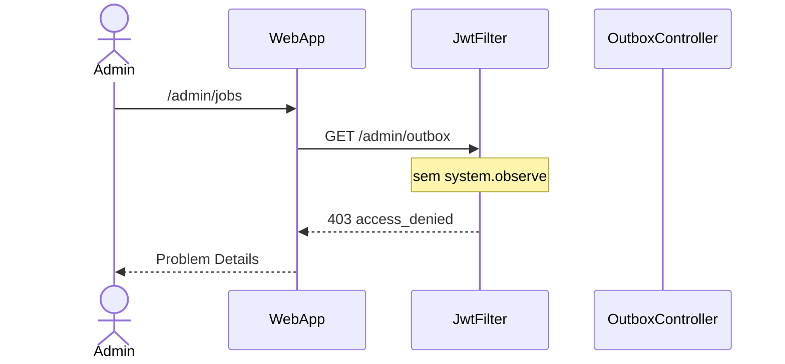

# F7.6-ERRO-01 — 403 sem system.observe

| Campo | Valor |
|---|---|
| HU | US-F7-005 |
| Escopo | acesso a `/admin/jobs` / outbox sem capability |
| Atores | Admin, WebApp, JwtFilter, OutboxController |
| Pré-condições | JWT válido; sem `system.observe` |
| Origem | `docs/tcc-docs.md` §8.8 |

## Passos

1. Tentativa de listar/reentregar.
2. `@PreAuthorize` → `403` (DRY F7.1-ERRO-01).

## Mermaid

## Export

[`F7.6-ERRO-01-sem-system-observe.puml`](./F7.6-ERRO-01-sem-system-observe.puml)
