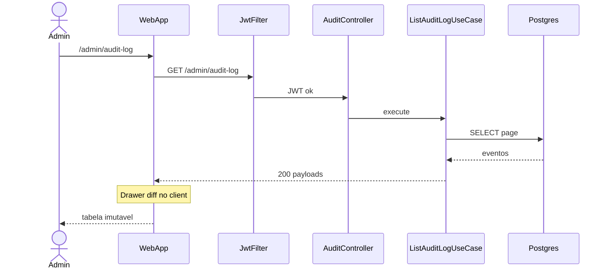

# F7.7-D01 — Listar trilha de auditoria

| Campo | Valor |
|---|---|
| HU | US-F7-006 |
| Escopo | `GET` audit-log + filtros; diff no Drawer (client) |
| Atores | Admin, WebApp, JwtFilter, AuditController, ListAuditLogUseCase, Postgres |
| Pré-condições | `audit.read` |
| Origem | `docs/tcc-docs.md` §8.8 · CA-01 · CA-05 |

## Passos

1. Admin abre `/admin/audit-log` (default: último ano, DESC).
2. Payload antes/depois na lista → Drawer/diff **sem** HTTP extra.
3. Sem `_links` de mutação; API sem DELETE/PATCH.

## Mermaid

## Export

[`F7.7-D01-listar-audit-log.puml`](./F7.7-D01-listar-audit-log.puml)
