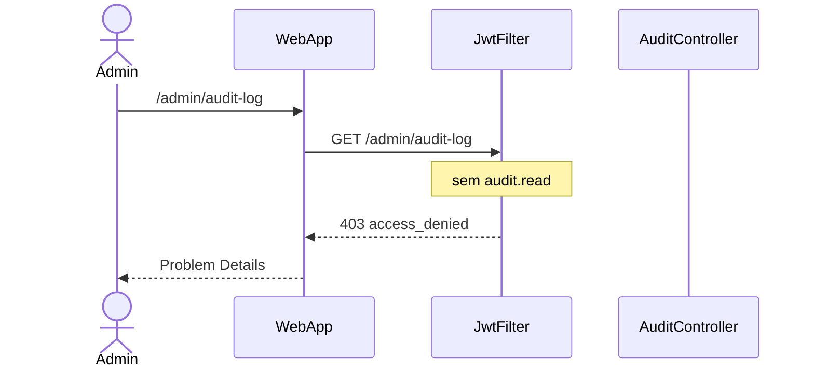

# F7.7-ERRO-01 — 403 sem audit.read

| Campo | Valor |
|---|---|
| HU | US-F7-006 |
| Escopo | acesso ao audit-log sem capability |
| Atores | Admin, WebApp, JwtFilter, AuditController |
| Pré-condições | JWT válido; sem `audit.read` |
| Origem | `docs/tcc-docs.md` §8.8 |

## Passos

1. Tentativa de `/admin/audit-log`.
2. `@PreAuthorize` → `403` (DRY F7.1-ERRO-01).

## Mermaid

## Export

[`F7.7-ERRO-01-sem-audit-read.puml`](./F7.7-ERRO-01-sem-audit-read.puml)
