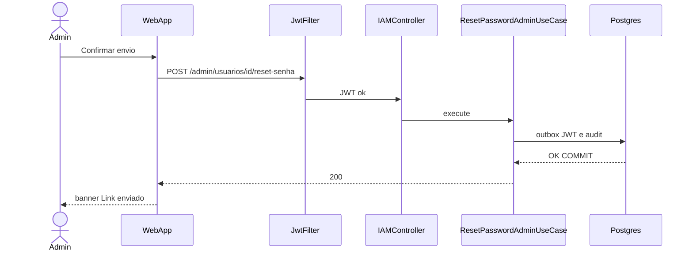

# F7.8-D04 — Reset de senha administrativo

| Campo | Valor |
|---|---|
| HU | US-F7-001 |
| Escopo | `POST .../reset-senha` + JWT 1-uso (24 h) + outbox |
| Atores | Admin, WebApp, JwtFilter, IAMController, ResetPasswordAdminUseCase, Postgres |
| Pré-condições | `user.reset_password`; usuário existe |
| Origem | `docs/tcc-docs.md` §8.8 · CA-04 |

## Passos

1. Modal só confirma envio — admin **não** vê senha nem link.
2. TX: outbox com link `/nova-senha?token=` + `audit_log` (`RESET_PASSWORD`).
3. Consumo do token → F0.3-a (DRY).

## Mermaid

## Export

[`F7.8-D04-reset-senha-admin.puml`](./F7.8-D04-reset-senha-admin.puml)
