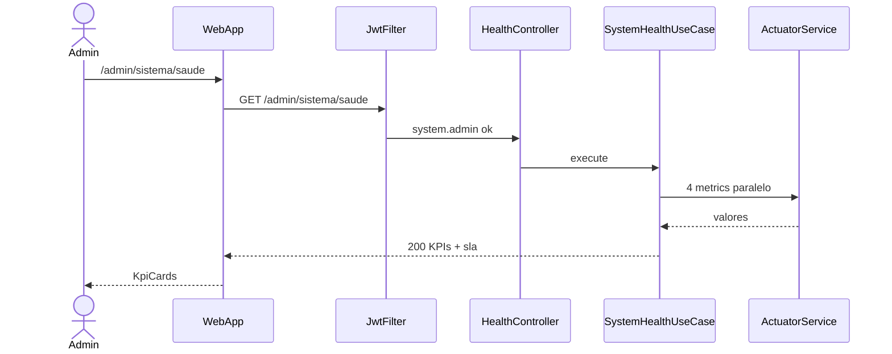

# F7.9-D01 — Carregar KPIs de saúde

| Campo | Valor |
|---|---|
| HU | US-F7-007 |
| Escopo | agrega Actuator interno → 4 KPIs + SLA |
| Atores | Admin, WebApp, JwtFilter, HealthController, SystemHealthUseCase, ActuatorService |
| Pré-condições | `system.admin`; Actuator habilitado |
| Origem | `docs/tcc-docs.md` §8.8 · CA-01 |

## Passos

1. Admin abre `/admin/sistema/saude`.
2. UseCase chama Actuator em paralelo (P95, outbox pending, 5xx, health) — **não** exposto ao browser.
3. `slaViolations[]` pinta danger; polling 30 s = mesmo GET (DRY).

## Mermaid

## Export

[`F7.9-D01-saude-sistema.puml`](./F7.9-D01-saude-sistema.puml)
