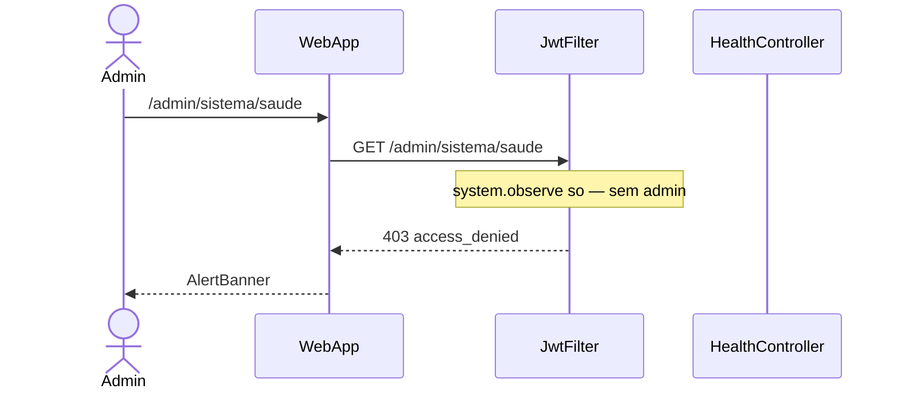

# F7.9-ERRO-01 — 403 sem system.admin

| Campo | Valor |
|---|---|
| HU | US-F7-007 |
| Escopo | `system.observe` **não** basta para saúde |
| Atores | Admin, WebApp, JwtFilter, HealthController |
| Pré-condições | JWT com `system.observe`; sem `system.admin` |
| Origem | `docs/tcc-docs.md` §8.8 · CA-05 |

## Passos

1. Tentativa de `/admin/sistema/saude`.
2. `@PreAuthorize('system.admin')` → `403`.
3. Quem tem só `system.observe` acessa F7.6/F7.7, não esta tela.

## Mermaid

## Export

[`F7.9-ERRO-01-sem-system-admin.puml`](./F7.9-ERRO-01-sem-system-admin.puml)
