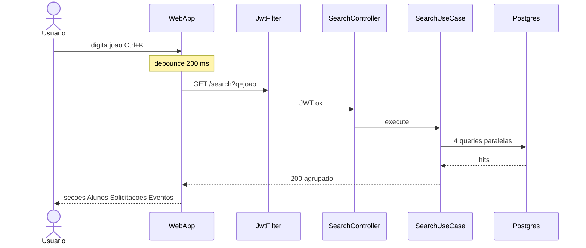

# F8.1-D01 — Busca global (debounce + fan-out)

| Campo | Valor |
|---|---|
| HU | US-F8-001 |
| Escopo | `GET /search?q=` — 4 índices paralelos + agrupamento |
| Atores | Usuario, WebApp, JwtFilter, SearchController, SearchUseCase, Postgres |
| Pré-condições | JWT válido; `q` ≥ 2 chars; `pg_trgm` |
| Origem | `docs/tcc-docs.md` §8.9 · CA-02 · CA-03 |

## Passos

1. Debounce 200 ms → GET `/search?q=`.
2. UseCase dispara queries paralelas (alunos, solicitações, eventos, users se `user.manage_all`).
3. UI agrupa por tipo; skeleton durante o loading.

## Mermaid

## Export

[`F8.1-D01-busca-global.puml`](./F8.1-D01-busca-global.puml)
