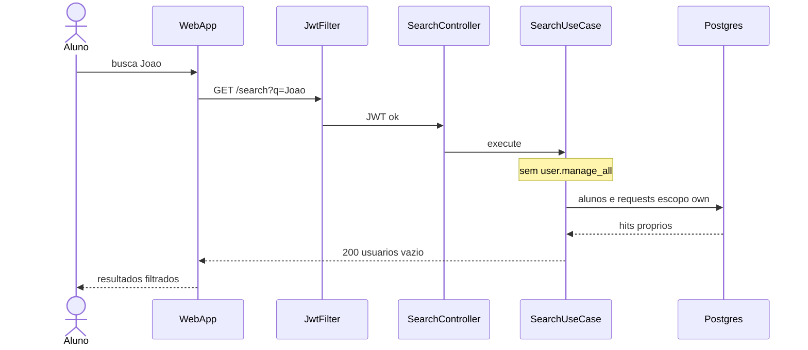

# F8.1-D02 — Fan-out FGAC (perfil aluno)

| Campo | Valor |
|---|---|
| HU | US-F8-001 |
| Escopo | mesmo `GET /search` com escopo por capability |
| Atores | Aluno, WebApp, JwtFilter, SearchController, SearchUseCase, Postgres |
| Pré-condições | JWT com `request.view_own` etc.; **sem** `user.manage_all` |
| Origem | `docs/tcc-docs.md` §8.9 · CA-04 |

## Passos

1. Aluno busca “João”.
2. Sem `user.manage_all` → índice users **omitido** (sem tocar a tabela).
3. Alunos/solicitações restritos ao próprio (`view_own`); `usuarios: []` é esperado.

## Mermaid

## Export

[`F8.1-D02-fanout-fgac-aluno.puml`](./F8.1-D02-fanout-fgac-aluno.puml)
