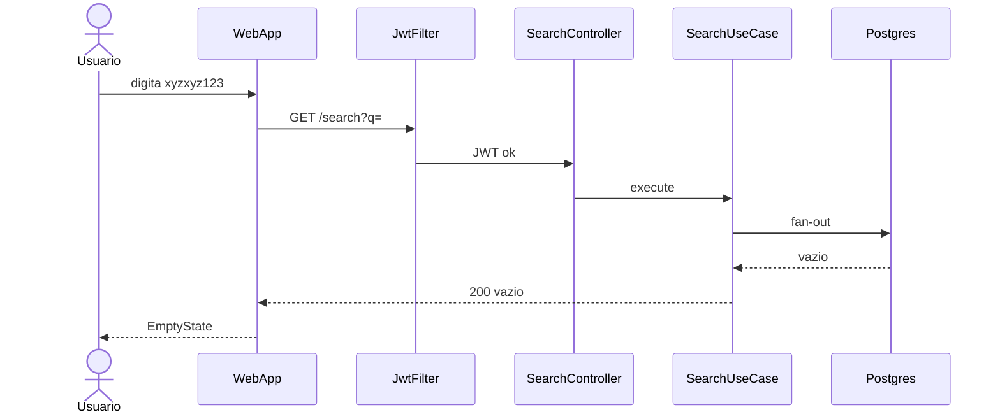

# F8.1-D03 — Sem resultados (EmptyState)

| Campo | Valor |
|---|---|
| HU | US-F8-001 |
| Escopo | `q` ≥ 2 chars; API `200` com arrays vazios |
| Atores | Usuario, WebApp, JwtFilter, SearchController, SearchUseCase, Postgres |
| Pré-condições | JWT válido; termo sem correspondência |
| Origem | `docs/tcc-docs.md` §8.9 · CA-08 |

## Passos

1. Mesmo fan-out de D01.
2. Resposta **200** vazia (não 404).
3. EmptyState: “Nenhum resultado encontrado para '…'”.

## Mermaid

## Export

[`F8.1-D03-sem-resultados.puml`](./F8.1-D03-sem-resultados.puml)
