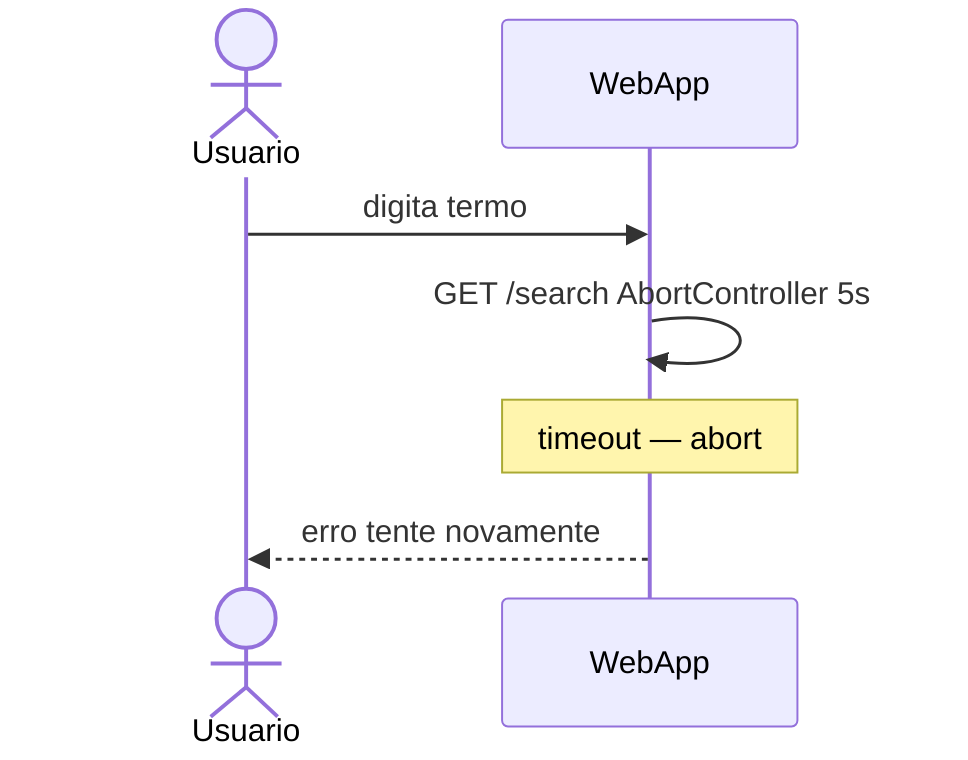

# F8.1-D04 — Timeout 5s no cliente

| Campo | Valor |
|---|---|
| HU | US-F8-001 |
| Escopo | `AbortController` cancela fetch após 5 s |
| Atores | Usuario, WebApp |
| Pré-condições | JWT válido; latência > 5 s ou rede instável |
| Origem | `docs/tcc-docs.md` §8.9 · RN-10 |

## Passos

1. GET `/search` inicia.
2. Cliente aborta aos 5 s — resposta do servidor descartada.
3. UI orienta “tente novamente” (não é 4xx/5xx do API).

## Mermaid

## Export

[`F8.1-D04-timeout-cliente.puml`](./F8.1-D04-timeout-cliente.puml)
