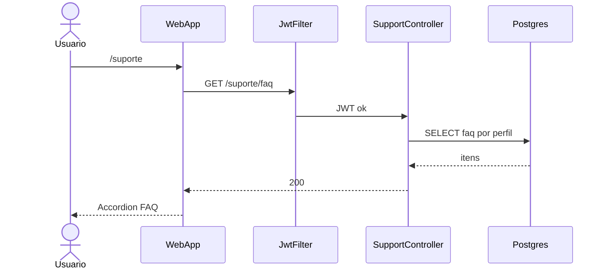

# F8.2-D01 — Carregar FAQ por perfil

| Campo | Valor |
|---|---|
| HU | US-F8-002 |
| Escopo | `GET /suporte/faq` ordenado por perfil |
| Atores | Usuario, WebApp, JwtFilter, SupportController, Postgres |
| Pré-condições | JWT válido; `faq_items` populados |
| Origem | `docs/tcc-docs.md` §8.9 · CA-01 |

## Passos

1. Usuário abre `/suporte`.
2. FAQ read-only; gestão dos itens é admin (fora desta HU).
3. Primeiro item `defaultOpen` no Accordion (UI).

## Mermaid

## Export

[`F8.2-D01-carregar-faq.puml`](./F8.2-D01-carregar-faq.puml)
