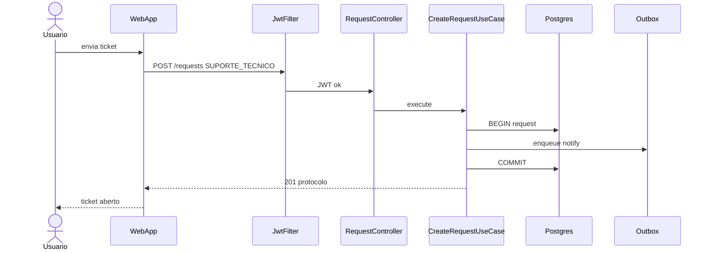

# F8.2-D02 — Abrir ticket (motor de solicitações)

| Campo | Valor |
|---|---|
| HU | US-F8-002 |
| Escopo | `POST /requests` com `tipoCodigo=SUPORTE_TECNICO` |
| Atores | Usuario, WebApp, JwtFilter, RequestController, CreateRequestUseCase, Postgres, Outbox |
| Pré-condições | JWT válido; rate limit OK; `RequestType` SUPORTE_TECNICO ativo |
| Origem | `docs/tcc-docs.md` §8.9 · CA-03 · CA-04 |

## Passos

1. Form → `CreateRequestUseCase` (mesmo motor genérico).
2. TX: `request` + `outbox` (notificar suporte).
3. 201 + protocolo; UI confirma e limpa o form.

## Mermaid

## Export

[`F8.2-D02-abrir-ticket.puml`](./F8.2-D02-abrir-ticket.puml)
