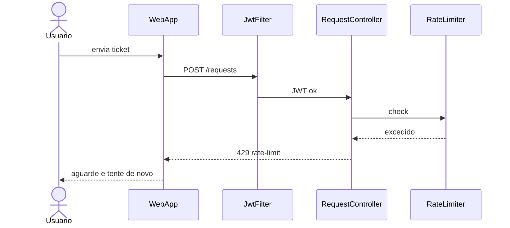

# F8.2-D03 — Rate limit ao abrir ticket

| Campo | Valor |
|---|---|
| HU | US-F8-002 |
| Escopo | janela in-memory; **429** antes de persistir |
| Atores | Usuario, WebApp, JwtFilter, RequestController, RateLimiter |
| Pré-condições | JWT válido; quota da janela esgotada |
| Origem | `docs/tcc-docs.md` §8.9 · CA-05 |

## Passos

1. POST `/requests` com `SUPORTE_TECNICO`.
2. RateLimiter rejeita → **429** `rate-limit` (sem INSERT).
3. UI exibe retry-after / mensagem amigável.

## Mermaid

## Export

[`F8.2-D03-rate-limit-ticket.puml`](./F8.2-D03-rate-limit-ticket.puml)
